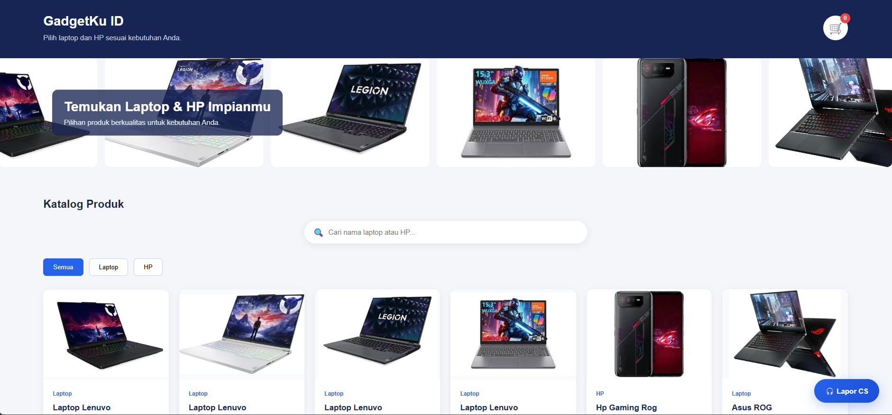

# GadgetKu ID – Aplikasi Penjualan Laptop dan Handphone Berbasis Web

## Deskripsi Proyek

GadgetKu ID merupakan aplikasi penjualan berbasis web yang dikembangkan untuk menyediakan layanan penjualan produk elektronik, khususnya laptop dan handphone. Aplikasi ini dirancang untuk memudahkan pengguna dalam mencari informasi produk, melihat spesifikasi, memilih barang, serta melakukan pembelian melalui sistem keranjang belanja.

Aplikasi ini memiliki dua bagian utama, yaitu halaman pengguna (frontend) dan halaman administrasi (admin). Pada halaman pengguna, pelanggan dapat menjelajahi katalog produk, melihat detail produk, menambahkan barang ke keranjang, dan melakukan proses pembelian. Sementara itu, halaman administrasi digunakan untuk membantu pengelola toko dalam mengelola produk dan memantau transaksi pelanggan.

GadgetKu ID dikembangkan dengan mengintegrasikan frontend, backend, dan basis data sehingga proses pengelolaan informasi produk maupun transaksi dapat dilakukan secara terstruktur.

## Teknologi yang Digunakan

- **React:** Digunakan untuk membangun antarmuka pengguna pada aplikasi.
- **JavaScript:** Digunakan untuk mengatur logika dan interaksi pada halaman aplikasi.
- **Flask:** Digunakan sebagai backend untuk menangani permintaan dan proses pengolahan data.
- **Python:** Digunakan sebagai bahasa pemrograman pada sisi backend.
- **MySQL:** Digunakan untuk menyimpan dan mengelola data produk serta transaksi.
- **HTML:** Digunakan sebagai struktur dasar halaman web.
- **CSS:** Digunakan untuk mengatur tampilan dan tata letak aplikasi.

## Fitur Aplikasi

- **Katalog Produk:** Menampilkan daftar produk laptop dan handphone yang tersedia di toko.
- **Kategori Produk:** Memudahkan pengguna dalam melihat produk berdasarkan kategori.
- **Detail Produk:** Menampilkan informasi produk secara lebih lengkap, seperti nama, harga, gambar, dan deskripsi.
- **Keranjang Belanja:** Memungkinkan pengguna menambahkan produk, mengubah jumlah barang, dan menghapus barang dari keranjang.
- **Proses Pembelian:** Menyediakan proses untuk melanjutkan pembelian produk yang telah dimasukkan ke keranjang.
- **Login Admin:** Menyediakan autentikasi bagi administrator untuk mengakses halaman pengelolaan.
- **Dashboard Admin:** Menyediakan halaman administrasi untuk mengelola informasi toko.
- **Manajemen Produk:** Memungkinkan admin mengelola data produk yang ditampilkan pada katalog.
- **Manajemen Transaksi:** Menampilkan data transaksi yang dilakukan oleh pelanggan.
- **Detail Transaksi:** Menampilkan informasi lebih lanjut mengenai transaksi yang dipilih.
- **Penghapusan Transaksi:** Memungkinkan admin menghapus data transaksi sesuai kebutuhan pengelolaan.

## Dokumentasi Aplikasi

# GadgetKu ID

